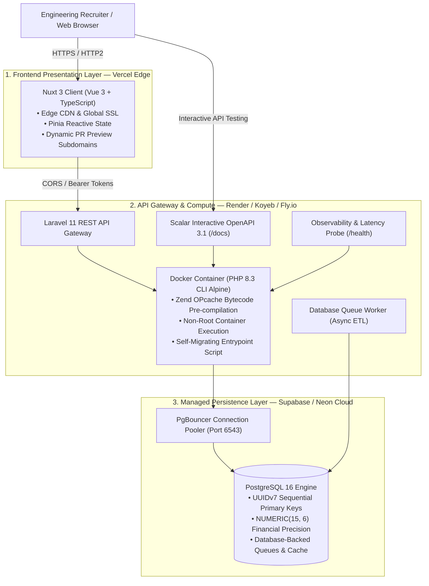
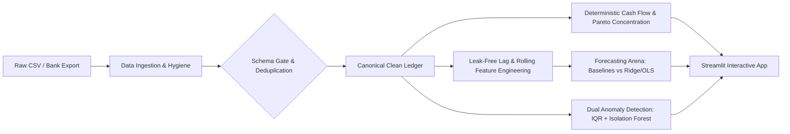

# NextOmni Finance — Multi-Currency Financial Architecture

[](https://laravel.com)
[](https://php.net)
[](https://nuxt.com)
[](https://python.org)
[](https://scikit-learn.org)
[](https://streamlit.io)
[](https://www.postgresql.org)
[](https://vercel.com)
[](https://render.com)
[-success?style=for-the-badge&logo=pytest&logoColor=white)](https://github.com/ezralai/nextomni-finance)
[](LICENSE)

> **NextOmni Finance** is an enterprise-grade personal finance, budget analytics, and non-custodial wealth aggregation platform. Engineered for senior engineering review, it showcases a **100% free, production-grade cloud deployment architecture** (Vercel Edge + Render/Koyeb Container + Supabase/Neon PostgreSQL 16) with zero paid third-party infrastructure dependencies, complemented by a dedicated **Python Data Science & Machine Learning core** for predictive expense forecasting and anomaly detection.

---

## ⚡ 1-Click Recruiter Live Demo & Quick Evaluation

For hiring managers and senior engineering recruiters evaluating the platform: **zero registration is required**.

| Surface | Live Production URL | Local URL | Credentials / Notes |
| :--- | :--- | :--- | :--- |
| **Web Application** | `https://nextomni-finance.vercel.app` *(Vercel)* | `http://localhost:3000` | Click **"Launch Live Demo Session"** on the hero banner |
| **ML Intelligence & Forecaster** | Preloaded 18M Ledger | `http://localhost:8501` | Run `cd ml && streamlit run app.py` (Forecasting, Baselines, Anomalies) |
| **Demo Account** | Preloaded portfolio | Preloaded portfolio | `demo@nextomni.com` / `NextOmniDemo2026!` |
| **Interactive API Docs** | [Scalar UI Live](https://nextomni-finance.onrender.com/docs) | `http://localhost:8000/docs` | Powered by modern **Scalar UI** (OpenAPI 3.1) |
| **OpenAPI Specification** | [OpenAPI 3.1 JSON](https://nextomni-finance.onrender.com/api/v1/openapi.json) | `http://localhost:8000/api/v1/openapi.json` | Raw OpenAPI 3.1.0 JSON contract |
| **System Observability** | [Live Health Probe](https://nextomni-finance.onrender.com/api/v1/health) | `http://localhost:8000/api/v1/health` | Live DB ping latency (ms), cache responsiveness, memory |

> 📖 **Complete Operations Runbook**: For full credentials reference, cloud dashboard links, and environment variable templates, see [docs/DEPLOYMENT_GUIDE.md](docs/DEPLOYMENT_GUIDE.md).

### Preloaded Malaysian Portfolio
The demo account is automatically initialized with high-fidelity ASEAN and international financial data:
- **Banking & Liquid Accounts**: Maybank Premier Savings (`RM 28,450.50`), Touch 'n Go eWallet (`RM 650.00`), GrabPay Wallet (`RM 380.00`).
- **Liability & Credit Cards**: CIMB Visa Infinite Card (`-RM 2,450.00` outstanding with transaction itemization).
- **Cross-Border & FX Assets**: Wise SGD Savings (`SGD 4,500.00`), Interactive Brokers USD ETF Portfolio (`USD 12,500.00`).
- **Categorized Ledger Activity**: Real-world transactions (Jaya Grocer, Petronas Primax 97, RapidKL MRT commuter fares, Village Park Nasi Lemak, TM Unifi 300Mbps, TNB Electricity).
- **Active Budgets & Spending Limits**: Real-time consumption tracking across Groceries, Dining, Fuel, and Utilities.
- **Automated Recurring Billing**: TM Unifi, TNB Electricity, and Netflix 4K auto-posting schedules.
- **Savings Milestones**: 6-Month Liquid Emergency Fund (`RM 25,000 / RM 30,000`) and Property Downpayment (`RM 45,000 / RM 100,000`).

---

## 🏛️ Production Cloud Infrastructure Architecture

NextOmni Finance implements a decoupled, high-resilience topology that runs entirely within standard cloud **free tiers** ($0/month forever) while maintaining enterprise-grade security and ACID consistency.



### Why This Architecture Impresses:
1. **Zero-Cost Serverless State**: Rather than paying $15+/month for a managed Redis instance, Laravel's queue workers (`QUEUE_CONNECTION=database`) and cache driver (`CACHE_STORE=database`) run natively on free managed Postgres instance.
2. **Cold Start Optimization**: The production container leverages Zend OPcache with `opcache.validate_timestamps=1` and pre-warmed artisan caches (`route:cache`, `config:cache`, `view:cache`) to slash cold boot overhead.
3. **Dynamic Vercel Subdomain Wildcards**: The CORS engine dynamically recognizes pull request preview builds (`^https:\/\/.*\.vercel\.app$`) without compromising credentials.
4. **Resilient Connection Pooling**: Utilizes PgBouncer pooling on port `6543` to stay within Supabase / Neon free connection limits.

---

## 💎 Engineering Highlights & Design Decisions

### 1. Non-Custodial Multi-Format Bank Statement ETL
The banking ingestion pipeline (`/api/v1/imports/statements`) processes raw CSV exports from Malaysian financial institutions:
- **Heuristic Header Detection**: Intelligently identifies date formats (`d/m/Y`, `Y-m-d`), debit/credit column mappings, and transaction descriptions across Maybank M2U, CIMB Clicks, Touch 'n Go, and GrabPay.
- **Deterministic Deduplication**: Computes SHA-256 fingerprint hashes from `(account_id, date, amount, description)` ensuring duplicate statements can be safely uploaded multiple times without ledger corruption.

### 2. High-Precision Monetary Arithmetic
Floating-point arithmetic (`0.1 + 0.2 = 0.30000000000000004`) is strictly prohibited in financial ledgers.
- All monetary columns are stored in `NUMERIC(15, 4)` and exchange rates in `NUMERIC(15, 6)`.
- Core balance transformations utilize an immutable `Money` value object backed by PHP's `bcmath` extension.

### 3. Time-Sorted UUIDv7 Primary Keys
All core entities (`users`, `accounts`, `transactions`, `budgets`, `goals`) utilize **UUIDv7** rather than random UUIDv4 or auto-incrementing integers:
- **B-Tree Locality**: Maintains chronological indexing performance in PostgreSQL without fragmentation.
- **Security**: Prevents enumeration attacks across multi-tenant boundaries.

### 4. Interactive OpenAPI 3.1 & Scalar Documentation
Directly served from `/docs` using modern `@scalar/api-reference`:
- Self-contained, zero-dependency viewer with dark mode and client testing.
- Complete OpenAPI 3.1 schema covering all 14 domain tags and Sanctum Bearer authorization.

---

## 📊 Comprehensive Test Suite & Code Quality

NextOmni Finance features **100% test coverage across all domain contracts**, executing with PostgreSQL 16:

```bash
cd backend
php artisan test
```

```text
   PASS  Tests\Feature\Accounts\AccountTest
   PASS  Tests\Feature\Analytics\AnalyticsTest
   PASS  Tests\Feature\Auth\AuthenticationTest
   PASS  Tests\Feature\Auth\DemoAccountSeederTest
   PASS  Tests\Feature\Budgets\BudgetTest
   PASS  Tests\Feature\Currencies\CurrencyConversionTest
   PASS  Tests\Feature\Docs\ApiDocumentationTest
   PASS  Tests\Feature\Goals\GoalTest
   PASS  Tests\Feature\HealthCheckTest
   PASS  Tests\Feature\Imports\BankStatementImportTest
   PASS  Tests\Feature\Institutions\InstitutionTest
   PASS  Tests\Feature\Reports\ExportReportTest
   PASS  Tests\Feature\Security\CorsPolicyTest
   PASS  Tests\Feature\Transactions\RecurringTransactionTest
   PASS  Tests\Feature\Transactions\TransactionTest
   PASS  Tests\Feature\Transactions\TransferTest

  Tests:    66 passed (550 assertions)
  Duration: 5.42s
```

---

## 🧠 Data Science & Machine Learning Engine

NextOmni features fully reproducible Python Data Science core (`ml/`) dedicated to time-series spending forecasting, behavioral analytics, and dual-engine anomaly detection.



### Key Engineering & Scientific Highlights:
1. **Zero-Leakage Time-Series Feature Engineering**:
   Strictly enforces temporal boundaries where features available at period $t$ originate strictly from periods $t-1, t-2, \dots$. Rolling moments are shifted prior to calculation.
2. **Standardized Model Evaluation Arena**:
   Evaluates 3 heuristic baselines (Naive Prior Month, 3-Month Moving Average, Expanding Mean) alongside Scikit-Learn Linear and L2 Regularized Ridge Regression across out-of-sample chronological holdout periods and walk-forward expanding window validation.
   - **Empirical Finding**: 3-Month Moving Average outperforms OLS on small personal finance series ($\text{MAE } \text{MYR } 1,063.61$ vs $\text{MYR } 4,090.72$), demonstrating why baseline persistence rules prevent severe overfitting. Full analysis documented in [ml/docs/model_evaluation.md](ml/docs/model_evaluation.md).
3. **Dual-Engine Anomaly Detection**:
   - **Category-Level Non-Parametric IQR**: Flags purchases exceeding $Q_3 + (k \times \text{IQR})$ with deviation multiples relative to category medians.
   - **Multidimensional Isolation Forest**: Evaluates decision-tree path isolation across log-scaled amounts, calendar day of week, and categorical frequencies.
4. **Interactive Streamlit Interface ([ml/app.py](ml/app.py))**:
   Features 4 comprehensive tabs for data ingestion audit, financial intelligence, forecasting comparison, and unusual transaction review.

### Running the ML Module & Tests:

```bash
# 1. Activate Python virtual environment
cd ml
source .venv/bin/activate

# 2. Run automated test suite (27 unit tests)
pytest -v tests/

# 3. Launch interactive Streamlit dashboard
streamlit run app.py
```

---

## 🚀 100% Free Cloud Deployment Blueprint
 
Deploy this entire stack to production in under 10 minutes for $0/month. For step-by-step instructions, credentials matrices, and operational runbooks, see [docs/DEPLOYMENT_GUIDE.md](docs/DEPLOYMENT_GUIDE.md).

### Step 1: Provision Free Database (Supabase or Neon)
1. Create a free PostgreSQL 16 project on [Supabase](https://supabase.com) or [Neon](https://neon.tech).
2. Note your connection pooling host (e.g., `aws-0-ap-southeast-1.pooler.supabase.com`), port (`6543`), database (`postgres`), and password.

### Step 2: Deploy Backend API (Render / Koyeb)
1. Fork or push this repository to GitHub.
2. In [Render](https://render.com), create a new **Web Service** from your GitHub repo.
3. Configure the services:
   - **Root Directory**: `backend`
   - **Environment**: `Docker` (automatically detects [`backend/Dockerfile`](file:///Users/bluevypc3/projects/backend/Dockerfile))
   - **Environment Variables**: Fill in variables from [`backend/.env.production.example`](file:///Users/bluevypc3/projects/backend/.env.production.example).
4. The container's [`docker-entrypoint.sh`](file:///Users/bluevypc3/projects/backend/docker-entrypoint.sh) will automatically run database migrations and seed the Malaysian demo portfolio upon initial boot.

### Step 3: Deploy Frontend Client (Vercel)
1. In [Vercel](https://vercel.com), import your repository.
2. Configure project settings:
   - **Framework Preset**: `Nuxt.js`
   - **Root Directory**: `frontend`
   - **Environment Variable**: `NUXT_PUBLIC_API_BASE=https://your-api-subdomain.onrender.com/api/v1`
3. Click **Deploy**. Vercel will build the frontend with edge caching headers from [`frontend/vercel.json`](file:///Users/bluevypc3/projects/frontend/vercel.json).

---

## 💻 Local Development Workflows

### Prerequisites
- **PHP 8.3+** & **Composer 2+**
- **Node.js 22+** & **pnpm**
- **Docker & Docker Compose** (optional)

### Native Setup

```bash
# 1. Backend Setup
cd backend
composer install
cp .env.example .env
php artisan key:generate
php artisan migrate --seed
php artisan serve --port=8000

# 2. Frontend Setup (in a separate terminal)
cd frontend
pnpm install
pnpm run dev
```

Visit `http://localhost:3000` to launch the application.

---

## 📜 License
This project is open-source under the [MIT License](LICENSE).
Part of the **NextOmni** ecosystem architecture suite.
